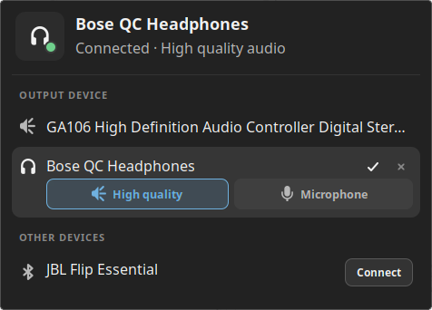
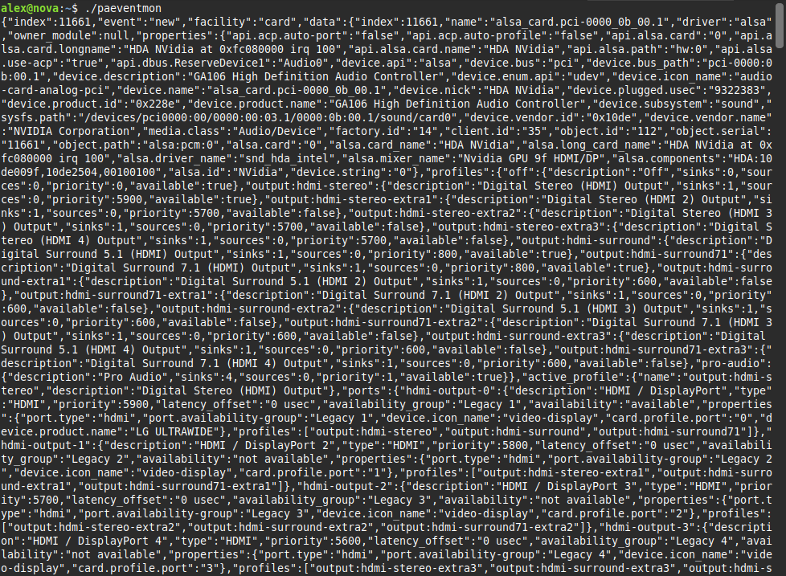

`paeventmon` is a tool that wraps the PulseAudio streaming API designed to support applications that need
a view on the system's audio state but which cannot call the pulseaudio API directly.



_Example client application (a desklet for selecting the current audio output device)_

## Building

### Prerequisites

- Rust toolchain (install via [rustup](https://rustup.rs) or your distro)
- PulseAudio development headers:

  **Debian/Ubuntu:**
  ```sh
  sudo apt install libpulse-dev
  ```

  **Fedora:**
  ```sh
  sudo dnf install libpulse-devel
  ```

  **Arch:**
  ```sh
  sudo pacman -S libpulse
  ```

### Build

```sh
cargo build --release
```

The binary is written to `target/release/paeventmon`.

## Download

Or simply download the latest release from the [releases page](https://github.com/alexspurling/pulse-audio-event-monitor/releases).

## Usage

The tool has no command line arguments and only has dependencies on the PulseAudio library (libpulse.so)
and libc.

To run, simply execute the binary.

```sh
$ ./paeventmon
[initial state as JSON (one line per resource)]
Listening for events... (Ctrl+C to quit)
```

The full state of the audio system is printed to stdout upon startup where each resources is printed as
a JSON object on a single line. Any change to the state will be emitted as a JSON object on a new line.

### Output format

Every line of stdout is a JSON object with these event types:

| Event type | Fields |
|---|---|
| `"new"` | `index`, `event`, `facility`, `data` — full entity snapshot emitted during startup |
| `"change"` | `index`, `event`, `facility`, `prop`, `old`, `new` — a single changed property |
| `"remove"` | `index`, `event`, `facility` — entity deleted |

The `facility` field identifies the PulseAudio entity type: `sink`, `source`, `sink-input`,
`source-output`, `module`, `client`, `sample-cache`, `server`, or `card`.

### stdout vs stderr

To simplify things for clients, all JSON output is written to **stdout**. Any errors or warnings are 
written to **stderr**.

## Comparison with `pactl`

PulseAudio already provides a command line tool for viewing the audio state of the system called `pactl`.
This is also a wrapper around the PulseAudio API. However, if you want to build a GUI application that
responds in real time to changes in the audio state, you would need to make multiple calls to `pactl`.

### Example 1: Changing the volume

When running `pactl subscribe`, a volume change event might look like this:

```sh
$ pactl subscribe
Event 'change' on sink #11927
Event 'change' on sink #11927
Event 'change' on sink #11927
```

When these events are received, it's up to the client application to query for the new state of sink 
#11927 to find out what the new volume level is.

With this tool, the value of every changed property is emitted as an event (one per line).

```sh
$ paeventmon
{"index":11927,"event":"change","facility":"sink","prop":"volume.front-left.value","old":42485,"new":42983}
{"index":11927,"event":"change","facility":"sink","prop":"volume.front-left.value_percent","old":"65%","new":"66%"}
{"index":11927,"event":"change","facility":"sink","prop":"volume.front-left.db","old":"-11.29 dB","new":"-10.99 dB"}
{"index":11927,"event":"change","facility":"sink","prop":"volume.front-right.value","old":42485,"new":42983}
{"index":11927,"event":"change","facility":"sink","prop":"volume.front-right.value_percent","old":"65%","new":"66%"}
{"index":11927,"event":"change","facility":"sink","prop":"volume.front-right.db","old":"-11.29 dB","new":"-10.99 dB"}
```

### Example 2: Initialisation

Initialising a client application with the current audio state.

When using `pactl`, because retrieving the full state of the audio stystem requires multiple calls, it's possible
to miss events which could lead to a client application being out of sync with the actual system.

When initialising `paeventmon`, you will get the full current state of the system as a series of "new" events 
(one per line).



This allows your application to have the full state of the audio system available immediately with no polling 
or querying required. Simply filter on the events you are interested in.

### Safety

The application is written in Rust and as far as I can tell is relatively stable. You should also have no problem
running multiple instances. However, it does depend on the PulseAudio library which is written in C not guaranteed
to be bug-free itself.
